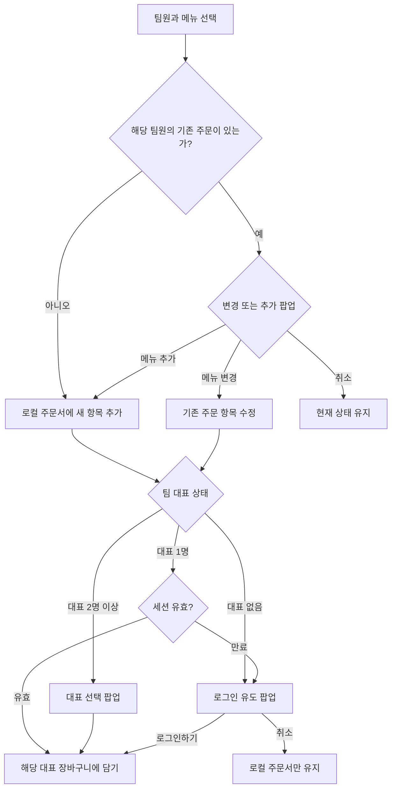

# 허다방 기능·UI UX 리뉴얼 기획안

- 문서 상태: 로컬 구현 및 자동화 검증 완료 (운영 배포·실계정 검증 전)
- 작성일: 2026-11-08
- 대상 서비스: `https://heodabang.me`
- 핵심 방향: 다중 주문, 대표 선택, 실시간 장바구니, 관리자 통합, 릴리즈 노트

## 1. 한눈에 보는 목표

허다방을 다음 네 가지 흐름으로 재구성한다.

1. 한 사람이 같은 날 여러 메뉴를 주문할 수 있다.
2. 주문자는 팀 대표 중 누구의 투썸 장바구니에 담을지 선택할 수 있다.
3. `실시간 장바구니`와 `과거 주문 내역`을 명확히 구분한다.
4. 관리자 기능과 릴리즈 노트를 기존 설정·건의사항 화면에 통합한다.

> 기본 원칙: 로컬 주문서는 항상 먼저 저장한다. 대표 로그인이나 외부 연동 실패로 사용자의 주문을 잃지 않는다.

## 2. 현재 문제와 개선 방향

| 현재 | 문제 | 개선 |
| --- | --- | --- |
| 1인 1일 1주문 강제 | 두 번째 메뉴는 기존 주문을 교체해야 함 | 변경과 추가를 선택하고 여러 주문 행을 허용 |
| 로그인한 대표 한 명의 장바구니만 사용 | 다른 대표의 장바구니를 선택할 수 없음 | 주문 시 대표 선택 팝업 제공 |
| 대표 목록이 전체 부서 기준으로 조회 | 다른 부서 대표도 섞일 수 있음 | 현재 부서 기준으로 필터링 |
| 초대코드로 PIN 최초 설정 | 불필요한 발급·전달·입력 단계 | 팀원이 직접 대표 등록과 PIN 생성 |
| 장바구니와 과거 주문 내역이 한 화면에 혼재 | 현재 상태와 과거 기록을 구분하기 어려움 | `실시간 장바구니`와 `과거 주문 내역`을 별도 탭으로 분리 |
| 별도 `/admin` 사용 | 주문·설정 흐름이 끊김 | 설정에 관리자 기능을 통합하고 기존 URL은 리다이렉트 |
| 빈 장바구니가 단순 `비어 있습니다`로 표시 | 누구의 장바구니가 비어 있는지 알기 어려움 | 대표 이름과 마지막 확인 시각을 함께 표시 |
| 결과 안내가 저장소별로 다르게 노출 | 로컬 저장과 외부 저장이 혼동됨 | 결과를 로컬 주문서와 실제 투썸 장바구니로 구분 |

## 3. 주요 사용자 흐름

### 3.1 메뉴 추가와 주문 저장



### 3.2 정확한 팝업 문구

기존 주문이 있는 사용자에게는 다음을 표시한다.

```text
메뉴를 변경하시겠습니까? 아니면 메뉴를 추가하시겠습니까?

[메뉴 변경] [메뉴 추가] [취소]
```

- `메뉴 변경`: 사용자가 선택한 기존 주문 항목을 수정한다.
- `메뉴 추가`: 기존 항목을 유지하고 새 주문 항목을 추가한다.
- `취소`: 기존 주문을 변경하지 않는다.
- 같은 메뉴와 옵션 조합이면 수량 증가를 우선 제안하고, 다른 메뉴·옵션이면 별도 항목으로 추가한다.

### 3.3 대표가 없을 때 로그인 유도

다음 문구를 그대로 사용한다.

```text
로컬 주문서에 저장했습니다.

실제 투썸플레이스 앱 장바구니에 저장하려면 로그인이 필요합니다.
로그인 하시겠습니까?

로그인하기 | 취소
```

- `로그인하기`: 대표 등록 → PIN 생성 → 투썸 로그인 순서로 이동한다.
- `취소`: 로컬 주문서만 유지하고 팝업을 닫는다.
- 취소하면 로컬 주문은 그대로 유지한다.

### 3.4 대표가 2명 이상인 팀

```text
누구의 투썸플레이스 앱 장바구니에 담을까요?

● 홍길동
  사용 가능 · 10분 전 사용

○ 김대리
  로그인 필요 · 선택할 수 없음

○ 박주임
  세션 만료 · 다시 로그인 필요

[선택한 대표 장바구니에 담기]
[팀 주문서만 유지]
```

- 매번 대표를 확인한다.
- 마지막 선택한 대표를 기본값으로 하되 자동 확정하지 않는다.
- 계정 아이디와 비밀번호는 표시하지 않는다.
- 사용 불가 대표는 이유를 보여주되 선택할 수 없게 한다.
- 팀 주문서만 유지하는 선택지를 항상 제공한다.

## 4. 화면별 UI UX 설계

### 4.1 주문 화면

상단에는 주문 진행 단계와 대표 상태를 함께 표시한다.

```text
이름 선택 > 메뉴 선택 > 옵션 선택 > 대표 선택

이 팀의 대표: 3명 · 장바구니 사용 가능 2명
홍길동, 김대리, 박주임
```

주요 개선 사항:

- 대표 이름과 사용 가능 여부를 주문 전에 볼 수 있다.
- `PIN 변경`, `대표 로그아웃`, `투썸 로그아웃`은 `내 대표 계정` 보조 메뉴로 이동한다.
- 퍼스널 옵션은 기본적으로 접고, 선택한 옵션만 한 줄로 요약한다.
- 한 사람의 주문 항목은 여러 개 추가할 수 있게 한다.
- 항목별로 `수량`, `옵션`, `수정`, `삭제`를 제공한다.
- 결과는 `로컬 주문서 저장`과 `실제 투썸 장바구니 반영`으로 구분한다.

주문자별 예시:

```text
허규선
  아메리칸호 · 아이스 · 레귤러 · 1개
  카페 라떼 · 핫 · 라지 · 1개

[메뉴 추가]
```

### 4.2 실시간 장바구니 탭

`내역` 최상위에 `실시간 장바구니`와 `과거 주문 내역`을 분리한다.

```text
실시간 장바구니 | 과거 주문 내역

대표: 홍길동 ▾                    [지금 새로고침]
현재는 홍길동의 장바구니가 비어 있습니다.
마지막 확인: 2026.11.08 22:03:12
```

표시 규칙:

- 현재 선택한 대표의 실제 투썸 장바구니를 조회한다.
- 주기적으로 새로고침하고 `지금 새로고침`도 제공한다. 권장 주기는 10~15초다.
- 마지막 확인 시각을 항상 표시한다.
- 항목이 없으면 `현재는 {대표명}의 장바구니가 비어 있습니다.`로 표시한다.
- 조회 실패 시 이전 항목을 실시간처럼 보여주지 말고 `조회 실패 · 이전 데이터`로 경고한다.
- 대표를 바꾸면 장바구니 소유자와 항목이 즉시 함께 바뀌어야 한다.
- 결제 완료 등으로 외부 장바구니가 비워지면 다음 조회부터 빈 상태로 바뀐다.

### 4.3 과거 주문 내역 탭

기존 날짜 조회 기능을 그대로 유지한다.

- 날짜 선택과 오늘 버튼 제공
- 팀원별 주문 상세
- 메뉴·옵션별 주문 수량
- 누가 어떤 대표 장바구니에 반영했는지 표시
- 로컬 주문서 삭제·수정은 현재 기록과 구분해 처리

과거 주문은 실제 결제 완료 여부를 의미하지 않는다. `로컬 주문서`와 `투썸 앱 결제 상태`를 혼동하지 않는다.

### 4.4 설정·관리자 통합

별도 `/admin` 대신 설정에 다음 탭을 둔다.

- 부서 관리
- 팀원 관리
- 매장·투썸 연동
- 대표 관리
- 릴리즈 노트 관리

현재의 빈 `주문 설정`은 다음 정보로 대체한다.

- 매장 영업시간과 현재 영업 상태
- 마지막 메뉴 갱신 시간과 자동 갱신 일정
- 로컬 주문서는 항상 저장 가능하다는 안내
- 매장 닫힘 시 외부 장바구니 담기가 제한된다는 안내

기존 `/admin`은 설정의 대표 관리 탭으로 리다이렉트한다. 관리자 인증은 유지한다.

## 5. 대표 등록과 초대코드 제거

초대코드는 제거하되, 대표 본인이 만드는 PIN은 유지한다.

```text
본인 팀원 선택 → 대표로 등록 → PIN 생성 → 투썸 로그인
```

요구 사항:

- 기존 팀원 목록에서 본인을 선택한다.
- 이름을 자유 입력하지 않는다.
- 같은 팀원의 중복 대표 등록을 막는다.
- 대표가 없으면 누구나 팀원으로 등록할 수 있다.
- 관리자도 대표를 추가·수정·삭제할 수 있다.
- PIN 생성과 변경은 본인만 수행하고 해시로 저장한다.

제거 대상:

- 초대코드 입력과 발급 화면
- 초대코드 검증 서비스와 API
- 초대코드 관련 DTO·저장소·엔티티
- 더 이상 사용하지 않는 `invite_code` 테이블

DB 정리는 코드 제거 후 별도 마이그레이션으로 진행하며, 대표 데이터는 삭제하지 않는다.

## 6. 백엔드·데이터 변경 사항

### 6.1 다중 주문 허용

현재 `OrderService`는 다음 검사로 1인 1일 1주문을 막고 있다.

```java
existsByTeamAndOrderDateAndDelYn(team, orderDate, "N")
```

다음을 변경해야 한다.

- 생성 시 중복 검사와 `이미 오늘 주문하셨습니다` 예외를 제거한다.
- `findTodayOrderByTeam`은 단건이 아니라 주문 목록을 반환하게 한다.
- 최근 주문 1건은 주문 작성을 돕는 참고 정보로만 사용하고, 유일한 주문으로 취급하지 않는다.
- 항목별 수정·삭제는 주문 ID 기준으로 처리한다.
- 집계는 모든 활성 주문 행을 포함한다.

### 6.2 대표 선택과 외부 장바구니

대표 응답에는 다음을 포함한다.

- 대표 멤버 ID
- 사람 이름
- 실제 부서명
- 투썸 세션 상태
- 사용 가능 여부와 이유

장바구니 요청에는 `targetRepMemberId`를 추가한다.

- 서버는 선택한 대표의 세션이 유효한지 확인한다.
- 해당 대표의 세션 키로만 외부 장바구니를 호출한다.
- 다른 대표의 비밀번호나 세션 토큰을 주문자 브라우저에 전달하지 않는다.
- 대표별 반영 기록을 남겨 감사와 오류 분석을 가능하게 한다.

### 6.3 반영 이력 보강

`cart_reflected_at`만으로는 부족하므로 다음을 추가한다.

- `cart_reflected_by`: 대표 멤버 ID
- `cart_no`, `cart_dtl_no`: 실제 장바구니 항목 식별자
- 반영 상태와 결과 메시지

기본 정책은 `한 로컬 주문 = 한 대표에게만 반영`이다. 다른 대표에게도 담는 기능은 명시적 예외로 제한한다.

## 7. 릴리즈 노트

### 7.1 팝업 표시 규칙

최신 공개 버전을 기준으로 **버전별·브라우저별·하루 1회** 표시한다.

```text
releaseNotice:{version}:dismissedOn = YYYY-MM-DD
```

- `닫기`: 현재 화면만 닫는다.
- `오늘 하루 보지 않기`: 해당 날짜를 저장하고 다음 날 다시 표시한다.
- 새 버전이 나오면 새 버전의 팝업을 다시 표시한다.
- 앱 첫 진입 때만 표시하고 탭 이동마다 반복하지 않는다.
- 날짜는 한국 시간 기준이다.

### 7.2 팝업 예시

```text
허다방 업데이트 안내
버전 2026.11.x

• 한 사람이 여러 메뉴를 주문할 수 있습니다.
• 팀 대표를 선택해 장바구니에 담을 수 있습니다.
• 실시간 장바구니와 과거 주문 내역이 분리되었습니다.

[자세히 보기]

[닫기] [오늘 하루 보지 않기]
```

### 7.3 자세히 보기

`자세히 보기`를 선택하면 건의사항 페이지로 이동하고, 선택한 릴리즈 노트를 강조해 표시한다.

표시 내용:

- 버전과 배포일
- 새 기능
- 개선 사항
- 제거된 기능
- 사용자에게 필요한 행동이나 제약

아래에는 `이 버전의 의견 남기기`를 제공한다.

관리자는 `설정 > 릴리즈 노트 관리`에서 작성·수정·공개한다.

권장 데이터:

- `id`, `version`, `title`, `summary`, `content`
- `published_at`, `is_published`
- `created_by`, `created_at`, `updated_at`

## 8. 상태별 처리 기준

| 상황 | 로컬 주문서 | 대표 선택 | 외부 장바구니 |
| --- | --- | --- | --- |
| 대표 없음 | 먼저 저장 | 로그인 유도 팝업 | 로그인 후 진행 또는 취소 |
| 대표 1명·세션 유효 | 저장 | 팝업 없이 해당 대표 사용 | 즉시 담기 |
| 대표 1명·세션 만료 | 저장 | 재로그인 또는 로컬만 유지 | 로그인 후 담기 |
| 대표 2명 이상 | 저장 | 매번 대표 선택 팝업 | 선택한 대표로 담기 |
| 매장 닫힘 | 저장 | 로그인을 강제하지 않음 | 차단하고 개장 후 일괄 담기 |
| 조회 실패 | 저장 | 이전 상태를 정상으로 오인하지 않음 | 실패를 표시하고 재시도 |
| 빈 장바구니 | 영향 없음 | 대표는 그대로 표시 | `현재는 {대표명}의 장바구니가 비어 있습니다` |

## 9. 비기능 요구 사항

- 모바일 버튼은 손가락으로 누르기 쉽게 최소 44px 높이를 확보한다.
- 상태는 색상뿐 아니라 텍스트로도 표현한다.
- 모달은 키보드 이동, Esc 닫기, 포커스 고정을 지원한다.
- 동일한 결과를 여러 팝업으로 중복 표시하지 않는다.
- 연속 클릭은 비활성화하고 서버에서도 중복 반영을 막는다.
- 메뉴 이미지는 지연 로딩하고, 대표별 세션 조회는 캐시한다.
- `OrderPage`는 주문 작성, 대표 선택, 장바구니 상태, 결과 모달로 분리한다.
- `OrderPage`와 `HistoryPage`의 대표 선택 컴포넌트는 재사용한다.

## 10. 단계별 구현 제안

### 1단계: 정책과 기반 정리

- 용어 통일
- 다중 주문 생성 규칙 변경
- 초대코드 제거
- 설정 내 관리자 통합과 `/admin` 리다이렉트

### 2단계: 대표 선택 주문

- 대표 자율 등록과 PIN 생성
- 대표 0명·1명·다수 대표 흐름
- 선택한 대표의 장바구니로 담기

### 3단계: 장바구니·내역 분리

- 실시간 장바구니 탭과 과거 주문 내역 탭 분리
- 대표별 빈 장바구니와 확인 시각 표시
- 반영 이력과 중복 방지 강화

### 4단계: 릴리즈 노트와 마무리 UX

- 팝업과 오늘 하루 보지 않기
- 건의사항 상세 연결
- 관리자 작성·공개 기능
- 모바일·키보드 접근성과 컴포넌트 분리

## 11. 최소 검증 시나리오

- [ ] 기존 주문이 없는 사람은 바로 주문 항목을 추가할 수 있다.
- [ ] 기존 주문이 있는 사람은 `메뉴 변경`, `메뉴 추가`, `취소`를 선택할 수 있다.
- [ ] 한 사람이 서로 다른 두 메뉴를 같은 날 주문할 수 있다.
- [ ] 대표가 없으면 지정한 로그인 문구와 `로그인하기 | 취소`가 표시된다.
- [ ] 대표가 1명이고 세션이 유효하면 팝업 없이 장바구니에 담긴다.
- [ ] 대표가 2명 이상이면 매번 대표 선택 팝업이 표시된다.
- [ ] 사용 불가 대표는 선택할 수 없고 이유가 표시된다.
- [ ] 매장이 닫혀 있어도 로컬 주문서는 저장된다.
- [ ] 대표별 장바구니 소유자와 빈 상태가 실시간 조회와 일치한다.
- [ ] 결제 완료로 외부 장바구니가 비워지면 다음 조회에서 빈 상태가 된다.
- [ ] 과거 날짜 주문 내역이 기존과 동일하게 조회된다.
- [ ] 연속 클릭으로 동일 항목이 중복 추가되지 않는다.
- [ ] `/admin`이 설정의 대표 관리 탭으로 이동한다.
- [ ] 릴리즈 노트는 하루에 한 번만 표시된다.
- [ ] `오늘 하루 보지 않기` 후 다음 날 다시 표시된다.
- [ ] 새 버전이 나오면 새 팝업이 표시된다.
- [ ] `자세히 보기`가 건의사항의 해당 릴리즈 노트로 연결된다.

## 12. 구현 범위에서 제외할 사항

- 실제 결제는 투썸하트 앱에서 수행한다.
- 대표 비밀번호나 세션 토큰을 주문자와 공유하지 않는다.
- 로컬 주문서를 실제 결제 완료로 간주하지 않는다.
- 관리자 전용 URL을 새로 추가하지 않는다.
- 초대코드는 재도입하지 않는다.

## 13. 구현 및 검증 메모

- 2026-11-09 기준으로 프론트엔드 5개 테스트 스위트 12개 테스트와 프로덕션 빌드를 통과했다.
- 백엔드 11개 테스트와 표준 `clean package`를 임시 Redis·인메모리 H2 환경에서 통과했다.
- 통합 테스트는 실제 MVC 요청으로 다중 주문, 대표 자율 등록, 대표별 세션 선택, 빈 장바구니, 과거 내역, 릴리즈 노트 공개와 `/admin` 리다이렉트를 검증했다.
- 실제 투썸 외부 호출은 모의 처리했으며, 운영 MySQL·Redis·투썸 계정과 장바구니는 변경하지 않았다.
- `V2__renewal.sql` 적용과 실제 대표 세션을 사용한 외부 장바구니 확인은 운영 배포 단계에서 수행한다.
